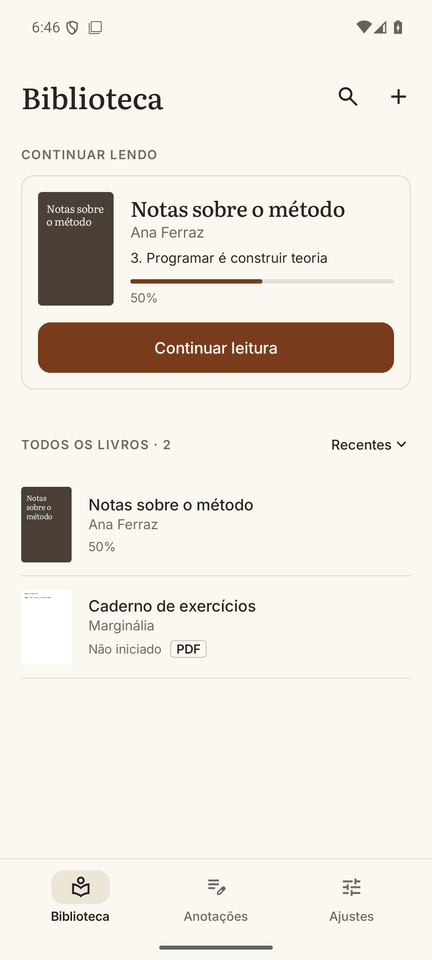
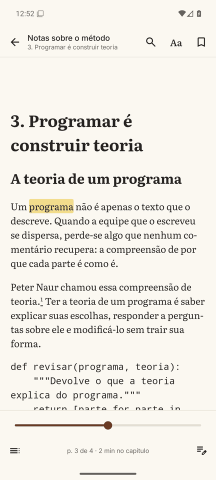
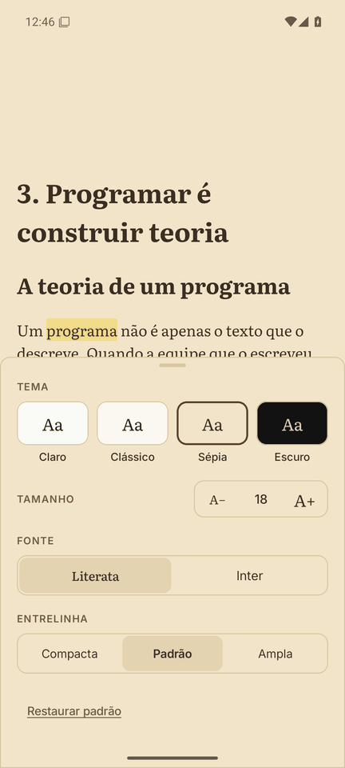
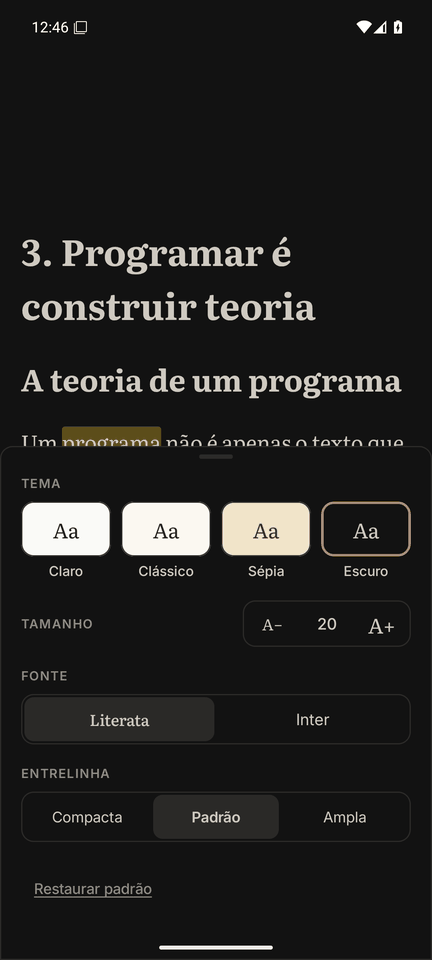
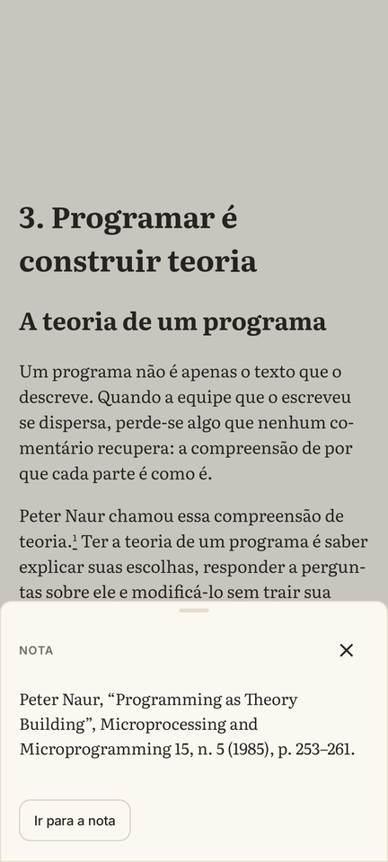
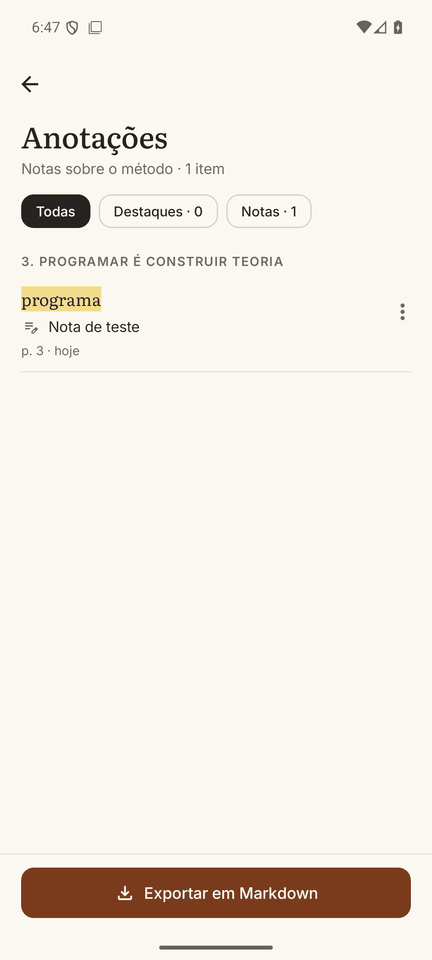
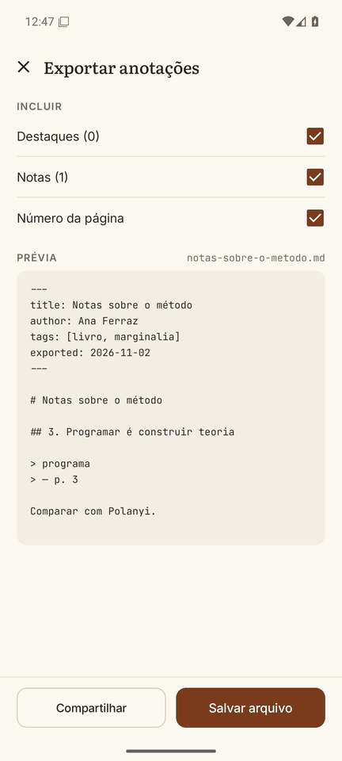

# Marginália

Leitor de EPUB e PDF para Android, feito para estudar: destacar, anotar, voltar ao trecho e levar as anotações para fora do app em Markdown. Sem conta, sem anúncios, sem coleta de dados e sem permissão de internet.

*A study reader for EPUB and PDF on Android. [English below](#english).*

<p>
  
  
  
  
</p>
<p>
  
  
  
</p>

## Estado do projeto

Versão inicial (0.1.0), ainda não publicada em loja. Os fluxos principais foram testados em emulador (Android 16), com um EPUB de teste, um livro real e um PDF. **Ainda falta testar em celulares reais** e com uma variedade maior de livros, então espere encontrar problemas. Relatos são bem-vindos nas [issues](../../issues).

## O que faz

- **Biblioteca:** adiciona EPUB e PDF pelo seletor de arquivos do Android. O arquivo continua onde está.
- **Leitura:** tela cheia e paginada; um toque no centro mostra as barras, um toque na borda vira a página. A posição é salva a cada página.
- **Quatro temas:** Claro, Clássico, Sépia e Escuro, aplicados também a menus e diálogos.
- **Texto:** Literata ou Inter, tamanho e entrelinha ajustáveis, com hifenização.
- **Estudo (EPUB):** destaques em 4 cores, notas, notas de rodapé em folha inferior, sumário, busca e marcadores.
- **Exportação:** Markdown compatível com Obsidian, com frontmatter YAML e agrupado por capítulo.
- **PDF:** leitura, sumário e marcadores. Destaques e notas são só para EPUB.
- **Idiomas:** português e inglês.

## Limitações conhecidas

- O número de página é a posição do Readium (cerca de 2.800 caracteres), não a página impressa.
- Blocos de código usam a fonte monoespaçada do livro ou do sistema.
- A estimativa de minutos só aparece quando cada capítulo está em um arquivo próprio do EPUB.
- A folha de nota de rodapé não mostra o número da nota.

Detalhes em [docs/BRAND.md](docs/BRAND.md).

## Como compilar

Requisitos: JDK 21 e Android SDK com a plataforma 37. O app roda no Android 10 ou mais novo.

```bash
./gradlew assembleDebug
```

```bash
./gradlew test
```

O APK de debug fica em `app/build/outputs/apk/debug/`. Para distribuir sua própria versão, assine com a sua chave e troque o `applicationId` em `app/build.gradle.kts`.

Livros de teste (ficam em `samples/`, fora do git):

```bash
python tools/make_samples.py
```

```bash
python tools/make_large_sample.py
```

## Tecnologia

Kotlin, Jetpack Compose e Material 3, [Readium Kotlin Toolkit](https://github.com/readium/kotlin-toolkit) para EPUB e PDF, Room, DataStore e Hilt. O código fica em `app/src/main/kotlin`, com pacotes por funcionalidade: `library`, `reader`, `annotations`, `settings` e `core`.

A marca e as telas de referência estão em [docs/BRAND.md](docs/BRAND.md). Os arquivos de `docs/design/` são as fontes do desenho original, feitas em um editor de canvas: guardam as decisões de layout, mas não abrem sozinhos em um navegador.

## Contribuir

Veja [CONTRIBUTING.md](CONTRIBUTING.md).

## Licença

[MIT](LICENSE): use, modifique e redistribua à vontade, inclusive comercialmente, mantendo o aviso de copyright. As fontes e bibliotecas incluídas têm licenças próprias, listadas em [THIRD_PARTY_NOTICES.md](THIRD_PARTY_NOTICES.md).

---

## English

Marginália is an Android reader for EPUB and PDF, built for studying: highlight, annotate, return to a passage and export your notes as Obsidian-compatible Markdown. No account, no ads, no data collection and no internet permission.

**Status:** early version (0.1.0), not on any store yet. Main flows were tested on an emulator only, so expect rough edges and please report them in the [issues](../../issues).

**Build:** you need JDK 21 and the Android SDK with platform 37. Run `./gradlew assembleDebug` and `./gradlew test`. The app runs on Android 10 or newer. To distribute your own build, sign it with your own key and change the `applicationId` in `app/build.gradle.kts`.

**License:** [MIT](LICENSE). Bundled fonts and libraries have their own licenses, listed in [THIRD_PARTY_NOTICES.md](THIRD_PARTY_NOTICES.md).
